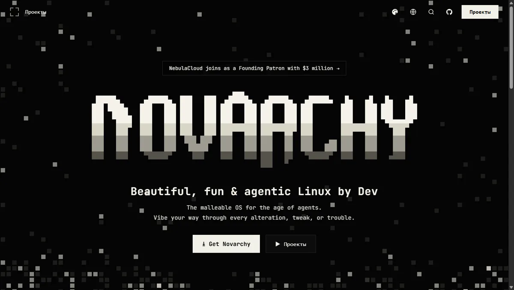

<div align="center">

```
███╗   ██╗  ██████╗  ██╗   ██╗  █████╗  ██████╗   ██████╗ ██╗  ██╗ ██╗   ██╗
████╗  ██║   ██╔═══██╗ ██║   ██║ ██╔══██╗ ██╔══██╗ ██╔════╝ ██║ ██╔╝ ╚██╗ ██╔╝
██╔██╗ ██║   ██║   ██║ ██║   ██║ ███████║ ██████╔╝ ██║      █████╔╝   ╚████╔╝
██║╚██╗██║   ██║   ██║ ██║   ██║ ██╔══██║ ██╔══██╗ ██║      ██╔═██╗    ╚██╔╝
██║ ╚████║   ╚██████╔╝  ╚████╔╝  ██║  ██║ ██║  ██║ ╚██████╗ ██║  ██║    ██║
╚═╝  ╚═══╝    ╚═════╝    ╚═══╝   ╚═╝  ╚═╝ ╚═╝  ╚═╝  ╚═════╝ ╚═╝  ╚═╝    ╚═╝
```

**An animated reimagining of omarchy.org — a pixel-art wordmark that assembles itself, typewriter headings and live theme switching. Pure HTML, CSS and JavaScript.**


</div>

---

Novarchy is a demo landing page inspired by [omarchy.org](https://omarchy.org), rebuilt from scratch with a focus on animation. The pixel-art hero collects itself out of falling sand, the "We can fix everything." heading types itself letter by letter, and a built-in theme picker re-skins the entire page live — like switching themes in Omarchy itself.

Everything is static: no frameworks, no build step, no dependencies. Fonts are bundled locally, so it works fully offline. Open `index.html` — that's the whole install.

## Features

| | |
|---|---|
| **Pixel wordmark** | The NOVARCHY logo assembles out of sand — a different entrance on every click |
| **Dust hero** | A living particle canvas: floating squares, bursts where you click |
| **Typewriter heading** | "We can fix everything." types itself with a blinking caret |
| **Live theme switcher** | Press `T` — a carousel of themes re-skins the page in real time |
| **Command palette** | Press `/` — quick search across the demo |
| **Local fonts** | Geist + JetBrains Mono in woff2, no CDN, works offline |

## Screenshot

<div align="center">
  
</div>

## Quick Start

```bash
git clone https://github.com/jermiDEV/novarchy
cd novarchy
```

Open `index.html` in a browser — or serve it locally:

```bash
python -m http.server 8080
```

## Hotkeys

| Key | Action |
|---|---|
| `T` | Open the theme picker |
| `/` | Open the command palette |
| `←` / `→` | Browse themes in the picker |
| `Enter` / `Esc` | Apply / close |

## Project Structure

```
index.html          Single-page demo
css/                Split stylesheets (tokens, base, hero, projects, overlays…)
js/                 Canvas engines: wordmark, pixel-hero, typing, themes, picker
fonts/              Geist + JetBrains Mono (woff2, bundled)
docs/               Screenshot for the README
```

## Credits

- Design inspired by [omarchy.org](https://omarchy.org) by DHH — this is a fan demo, not a copy
- Fonts: [Geist](https://vercel.com/font) by Vercel, [JetBrains Mono](https://www.jetbrains.com/lp/mono/)
